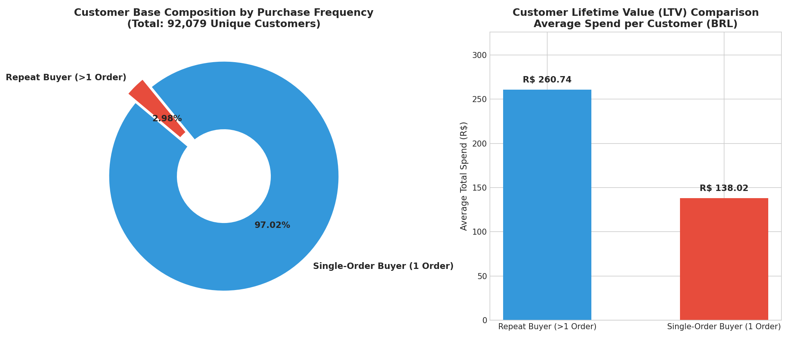
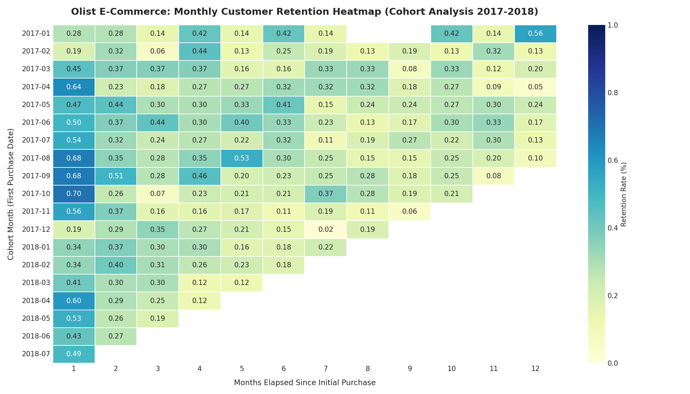
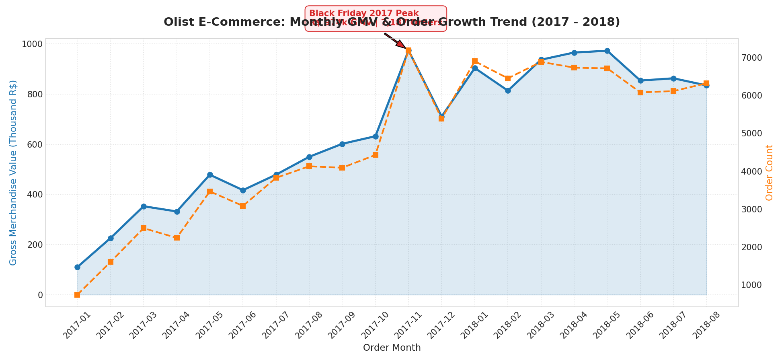
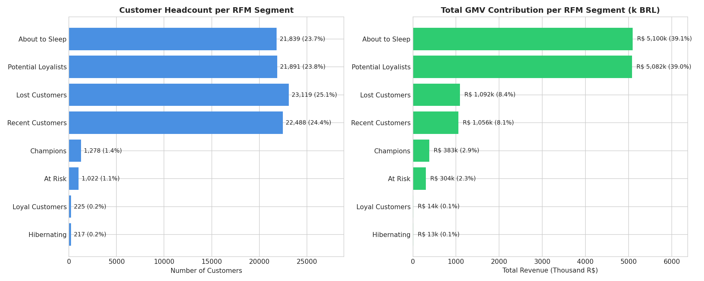

### Wang Cui | Data Science Portfolio

### About Me

I am Wang Cui, a university student learning data science and business analytics. I enjoy exploring real-world data, writing clean Python code, and finding practical answers to everyday business questions.

This website showcases my coursework projects and technical skills.

### Technical Skills

- Programming: Python, SQL (MySQL)
- Data Analysis & Processing: pandas, NumPy
- Data Visualization: Matplotlib, Seaborn
- Tools & Workflow: Jupyter Notebook, Git, Markdown

### Featured Project

#### E-commerce User Growth, Repurchase and Retention Analysis

- Project Status: Completed
- Project Repository: https://github.com/wangcui92/data-science-project
- Dataset: Brazilian E-Commerce Public Dataset by Olist on Kaggle (~100,000 real orders from 2016 to 2018)

#### 1. Research Questions

When running an online marketplace, getting new customers is expensive, so keeping existing customers is important. In this project, I investigated:
1. Sales Growth: How did sales and orders trend over time? What was the impact of major shopping events like Black Friday?
2. Repurchase Rate: How many customers actually came back for a second purchase? How do repeat buyers compare to one-time buyers?
3. Cohort Retention: When we group users by the month of their first purchase, how well does the platform retain them over 12 months?
4. Customer Segmentation (RFM): How can we divide customers into practical groups using Recency, Frequency, and Monetary value to see where revenue comes from?

#### 2. Methods

- Data Cleaning and Merging:
  - Filtered for delivered orders (order_status == 'delivered') to only count completed sales and exclude canceled or unavailable orders.
  - Converted purchase timestamps to datetime.
  - Combined order timestamps, item details, unique customer identifiers (customer_unique_id), and translated product categories using pandas.
- Metrics Calculation: Computed total GMV, unique customers, Average Order Value (AOV), and repeat purchase rates.
- Cohort Retention Analysis: Tracked monthly customer retention over a 12-month window for cohorts from 2017 to 2018.
- RFM Segmentation: Segmented customers into 8 practical groups based on median thresholds for Recency, Frequency, and Monetary value.

#### 3. Visualizations and Key Findings

##### Finding 1: Over 97% of Customers Bought Only Once, but Repeat Buyers Spend Double

Only 2.98% (2,742 people) of customers made more than one purchase, while 97.02% of users bought just once and never returned. 

This low repurchase rate is influenced by the platform's product categories, which mainly focus on durable goods like furniture, watches, and home decor, rather than high-frequency consumables like fresh food or daily necessities.

However, the customers who do come back spend an average of 265.80 reais, almost twice as much as the one-time buyers (137.14 reais). Even though repeat customers make up a tiny fraction of all users, their lifetime value is significantly higher.

##### Finding 2: Retention is Low Overall, but Black Friday Wakes Up Past Buyers

Across almost all cohorts, monthly retention in regular months is very modest, ranging between 0.3% and 0.8%. 

However, looking at the diagonal values corresponding to November 2017, retention bumps up noticeably across multiple cohorts (reaching 0.5% - 0.7% even 6 to 10 months after the initial purchase). This demonstrates that store-wide promotional events are the most effective trigger for bringing dormant buyers back.

##### Finding 3: Sales Grew Rapidly and Peaked in November 2017

Sales steadily increased overall between 2017 and 2018. The month with the biggest sales in the data was Black Friday in November 2017, with a total merchandise transaction amount of 973,978 reals, corresponding to 7,187 orders. After this peak, monthly sales stabilized at levels much higher than before (averaging around 800k to 900k BRL per month).

##### Finding 4: Two Single-Buyer Groups Generate 78% of Total Revenue

In the RFM customer segmentation:
- Potential Loyalists (recent high-spenders) and About to Sleep customers (older high-spenders) each make up ~24% of users, but together they account for 78.0% of all revenue.
- Champions (recent, repeat, high spend) represent only 1.4% of customers (1,305 people), yet they achieve the highest average spending (over 300 reais per customer).
- Because the platform relies so heavily on single-order high-value customers, timely cross-selling before they drift away is the single most valuable growth opportunity.

#### 4. Practical Business Takeaways

1. Focus on complementary items: Because people rarely replace durable goods right away, the platform should recommend accessories or cross-category items within 30 to 60 days of the first purchase.
2. Promotional campaigns work: Major discount events like Black Friday are essential for reactivating dormant accounts in low-frequency e-commerce.

#### 5. Project Limitations

1. No website traffic or browsing data: The dataset only records completed orders, so we cannot observe user browsing behavior or cart abandonment rates.
2. Missing platform marketing cost data: There is no data on customer acquisition costs (CAC) or ad spend, making it impossible to calculate the real ROI of marketing campaigns.
3. Early data scope: The data only goes up to the end of 2018, so it does not reflect later trends in Brazilian e-commerce or improvements in logistics.

### Peer Review and Improvement

I asked a friend to review my portfolio draft. They gave two helpful comments:
1. The cohort retention heatmap was hard to understand without clear notes on what the X-axis meant.
2. They asked why the repeat purchase rate was only 3% and wondered if that indicated bad customer service.

Improvement made:
- I updated the chart explanations above to clarify that the X-axis represents months elapsed since the first order.
- I added context explaining that Olist primarily sells durable products, where a 3% repeat rate is normal and expected.

### Future Development

In future projects, I plan to:
- Build a visual dashboard to make reports easier for non-technical users to explore.
- Analyze customer review texts to detect common product quality complaints.
